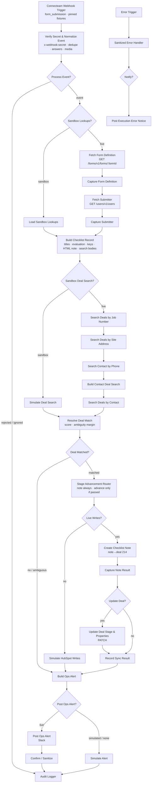

# n8n-connecteam-field-checklist-hubspot-deal-updater

**Connecteam field checklists → the right HubSpot deal → a readable checklist note → "Ready for Invoicing" when the job is truly done.**

I built this n8n workflow for field-service teams whose crews fill in pre-start, safety and job-completion checklists in Connecteam while the office runs the pipeline in HubSpot. When a crew submits a checklist, the workflow finds the matching deal by job number, site address or customer phone. It attaches an HTML note with every question, every answer and a photo and media log. When a job-completion checklist passes, it moves the deal to **Ready for Invoicing**. Safety issues, incomplete sign-offs and checklists it can't match go to an ops channel instead of being written to the wrong deal.

> **Safe by default.** `SANDBOX_MODE=true` and `DRY_RUN=true`. Out of the box, the workflow runs only against pinned fictional checklists. It makes no Connecteam, HubSpot or Slack calls until you turn both switches off.

Built by DH Robin · dhRobin Systems · MIT licensed.

---

## Table of Contents

1. [Why this exists](#1-why-this-exists)
2. [Architecture](#2-architecture)
3. [Repository layout](#3-repository-layout)
4. [Quick start](#4-quick-start)
5. [Connecteam webhook payloads & authentication](#5-connecteam-webhook-payloads--authentication)
6. [Checklist configuration & evaluation](#6-checklist-configuration--evaluation)
7. [HubSpot deal matching engine](#7-hubspot-deal-matching-engine)
8. [Checklist note & stage advancement](#8-checklist-note--stage-advancement)
9. [Environment variables](#9-environment-variables)
10. [Node configuration](#10-node-configuration)
11. [Testing stages](#11-testing-stages)
12. [Security & privacy model](#12-security--privacy-model)
13. [Troubleshooting](#13-troubleshooting)
14. [Known limitations](#14-known-limitations)
15. [Disclaimer & license](#15-disclaimer--license)

---

## 1. Why this exists

On most field-service teams, the checklist and the deal never meet. The technician ticks "All work completed", photographs the panel and collects a signature in Connecteam. Days later, someone in the office scrolls through the form feed, copies a few answers into HubSpot and drags the deal to invoicing. In practice:

- **Invoices wait** because nobody noticed the job-completion checklist came in.
- **Deals get invoiced too early** because someone moved the stage without checking that the work was finished or that the customer signed.
- **Safety findings stay in Connecteam.** A "No" on "Exposed wiring controlled?" never reaches the project manager who owns the deal.
- **Evidence goes missing.** When a customer disputes the job, the photos and signature aren't on the deal.

This workflow closes that gap. It acts on the checklist the moment it's submitted, puts the evidence on the deal, and changes the stage only when the evidence supports it.

## 2. Architecture



The required building blocks map to the nodes like this:

| Required component | Nodes |
|---|---|
| 1 · Connecteam Webhook Trigger | `Connecteam Webhook Trigger` (raw body on, 10 pinned fictional deliveries) |
| 2 · Signature Verification & Event Normalizer | `Verify Secret & Normalize Event`, the lookup branch, `Build Checklist Record` |
| 3 · HubSpot Deal Lookup & Matching Engine | the 4 search requests, `Build Contact Deal Search`, `Resolve Deal Match` (or `Simulate Deal Search`) |
| 4 · Checklist Note Attachment & Stage Advancement Router | `Stage Advancement Router`, `Create Checklist Note`, `Update Deal Stage & Properties`, `Record Sync Result` |
| 5 · Audit Logger & Sanitized Error Handler | `Audit Logger`, `Sanitized Error Handler`, the Slack sanitizer |

Sandbox and live paths come back together at the same nodes. Each simulator returns the same response shape as the live API, so a sandbox pass exercises the same matching, routing and logging code as production.

## 3. Repository layout

```
n8n-connecteam-field-checklist-hubspot-deal-updater/
├── README.md        ← this file
├── workflow.json    ← import into n8n (inactive, sandbox defaults, pinned fixtures)
├── DISCLAIMER.md
└── LICENSE          ← MIT
```

All logic lives in Code nodes inside `workflow.json`. There are no community nodes, and the workflow doesn't need stored n8n credentials, because every secret comes from an environment variable.

## 4. Quick start

1. In n8n, go to **Workflows → Import from File** and select `workflow.json`. The workflow imports **inactive**.
2. Open it and click **Execute Workflow**. The trigger replays 10 pinned fictional deliveries.
3. Open **Audit Logger**. You should see one record per delivery that matches the table in [Stage 1](#stage-1--sandbox-pinned-fixtures-no-network).
4. Open **Simulate HubSpot Writes (Dry Run)** to read the note HTML and the deal update that would have been sent.

### n8n platform prerequisites

| Setting | Why |
|---|---|
| `N8N_BLOCK_ENV_ACCESS_IN_NODE=false` | Code nodes read configuration through `$env`. If access is blocked, every helper falls back to the safe default (sandbox + dry run). |
| `NODE_FUNCTION_ALLOW_BUILTIN=crypto` | Needed for constant-time secret comparison. Without it, every delivery is rejected (`crypto_module_unavailable`), so the workflow fails closed. |
| Concurrency of 1 for this workflow (or queue mode with one worker) | Static data (dedupe ledger, audit ring buffer) isn't transactional. |
| Settings → Error Workflow = this workflow | Activates the sanitized error branch. |

## 5. Connecteam webhook payloads & authentication

### 5.1 Subscribing

In Connecteam, create a webhook (in the account's API and webhook settings, or with `POST https://api.connecteam.com/settings/v1/webhooks` and your API key; menu names vary by plan) for the **Forms** activity on the checklist forms you want to sync:

- **URL:** `https://YOUR_N8N_HOST/webhook/connecteam-checklist-submitted`
- **Events:** `form_submission` (add `form_submission_edited` only if you also set `PROCESS_EVENT_TYPES`; see 5.4)
- **Secret key:** a long random value. Store the same value in `CONNECTEAM_WEBHOOK_SECRET` and nowhere else.

### 5.2 Envelope

Connecteam posts a JSON envelope. The fields this workflow reads:

```json
{
  "requestId": "req-fixture-sub-ct-0003",
  "company": "Fictional Field Services Co",
  "activityType": "forms",
  "eventType": "form_submission",
  "eventTimestamp": 1794907205,
  "data": {
    "formSubmissionId": "sub-ct-0003",
    "formId": 7003,
    "submissionTimestamp": 1794907200,
    "submissionStartTimestamp": 1794906300,
    "submissionTimezone": "America/Chicago",
    "entryNum": 3,
    "submittingUserId": 501,
    "isAnonymous": false,
    "answers": [
      { "questionId": 301, "questionType": "openEnded", "value": "job-10422" },
      { "questionId": 303, "questionType": "phoneNumber", "value": "(555) 010-0142" },
      { "questionId": 304, "questionType": "yesNo", "selectedIndex": 0 },
      { "questionId": 308, "questionType": "group", "answers": [ { "questionId": 309, "questionType": "task", "isChecked": true } ] },
      { "questionId": 310, "questionType": "image", "images": [ { "url": "https://files.connecteam.example/sandbox/sub-ct-0003/image-1.jpg" } ] },
      { "questionId": 311, "questionType": "signature", "images": [ { "url": "https://files.connecteam.example/sandbox/sub-ct-0003/signature-1.jpg" } ] }
    ]
  }
}
```

The payload carries **question IDs but no question titles, no form name and no submitter name**. That's why the live path calls `GET /forms/v1/forms/{formId}` (scope `forms.read`) for titles and the form name, and the Users API for the submitter's display name. If either lookup fails, the sync carries on and labels answers "Question 304".

Answer values are normalised by `questionType`:

| Type(s) | Value read | Normalised as |
|---|---|---|
| `yesNo` | `selectedIndex` | Yes / No (`YES_NO_YES_INDEX`, default `0` = Yes), counts as a checkable item |
| `task` | `isChecked` | Done / Not done, counts as a checkable item |
| `multipleChoice`, `imageSelection` | `selectedAnswers[].text` | comma-joined |
| `openEnded`, `emailAddress`, `phoneNumber`, `slider` | `value` | trimmed text |
| `number` / `rating` / `formula` | `inputValue` / `ratingValue` / `result` | text |
| `datetime` | `timestamp`, `timezone` | ISO 8601 |
| `location` | `locationInput.address` | address text (coordinates are never copied) |
| `image`, `scanDocument`, `signature` | `images[].url` | media log (photo / scan / signature) |
| `video`, `audioRecording`, `files` | `videos[].videoUrl`, `audioUrl`, `files[].url` | media log |
| `group`, `multiGroup` | nested `answers` / `groupAnswers` | flattened, with a path prefix |
| `description` | none | skipped |

Answers flagged `wasHidden` are left out of the note and the evaluation. Answers flagged `wasSubmittedEmpty` are left out of the note unless `NOTE_INCLUDE_EMPTY_ANSWERS=true`.

### 5.3 Authentication (fails closed)

Connecteam webhooks are **not HMAC-signed**. When you set a secret key on the webhook, Connecteam sends that exact value in the `x-webhook-secret` header of every delivery. I verify it the only way that's possible: a constant-time comparison (SHA-256 both sides, then `crypto.timingSafeEqual`) against `CONNECTEAM_WEBHOOK_SECRET`.

| `CONNECTEAM_AUTH_MODE` | Checks | Use when |
|---|---|---|
| `header_secret` (default) | `x-webhook-secret` (or `CONNECTEAM_SECRET_HEADER`) equals the secret | Connecteam posts straight to n8n |
| `hmac_sha256` | `CONNECTEAM_SIGNATURE_HEADER` (default `x-signature`, `sha256=` prefix optional, hex or base64) equals HMAC-SHA256 of the raw body | A gateway or relay (for example Hookdeck or your own edge function) checks the Connecteam secret and re-signs deliveries |

Rejections are logged as `secret_header_missing`, `secret_mismatch`, `signature_header_missing`, `signature_mismatch`, `webhook_secret_not_configured` or `crypto_module_unavailable`. Nothing downstream runs.

A shared secret proves the sender knows the secret. It doesn't protect the body against tampering in transit, and it doesn't stop replays. So: use HTTPS only, rotate the secret if it's ever exposed, and rely on the submission-ID dedupe (5.4) to make replays harmless. If you need body integrity, put a re-signing gateway in front and use `hmac_sha256`.

### 5.4 Filters & idempotency

| Check | Default | Ignored as |
|---|---|---|
| `activityType` must be `forms` | — | `not_a_forms_event` |
| `eventType` in `PROCESS_EVENT_TYPES` | `form_submission` | `event_type_not_processed` |
| `formId` configured in `CHECKLIST_FORMS_JSON` | — | `form_not_configured` |
| `formSubmissionId` present | — | `missing_submission_id` |
| `eventType:formSubmissionId` not seen in this batch or the ledger | 30 days (`SUBMISSION_LEDGER_DAYS`) | `duplicate_submission` |

Connecteam retries a failed delivery up to 3 times, 60 seconds apart, and the webhook responds immediately, so a slow HubSpot call never causes a retry. A submission is added to the ledger only after its note is saved in HubSpot. A delivery that failed half-way can therefore be retried, and a retry of a successful one is ignored.

Edited submissions (`form_submission_edited`) are ignored by default. If you add them to `PROCESS_EVENT_TYPES`, they get a fresh note marked *edited submission*, but **they never move the stage**.

## 6. Checklist configuration & evaluation

### 6.1 `CHECKLIST_FORMS_JSON`

One entry per Connecteam form ID. Only listed forms are processed.

```json
{
  "7001": { "kind": "pre_start", "label": "Pre-Start Vehicle & Site Check", "advance": false, "jobIdQuestionId": "101", "minPhotos": 1 },
  "7002": { "kind": "safety", "label": "Site Safety Checklist", "advance": false, "jobIdQuestionId": "201", "addressQuestionId": "202",
            "safetyCriticalQuestionIds": ["203"], "minPhotos": 1 },
  "7003": { "kind": "job_completion", "label": "Job Completion Sign-off", "advance": true, "jobIdQuestionId": "301", "addressQuestionId": "302",
            "phoneQuestionId": "303", "minPhotos": 2, "requireSignature": true,
            "targetStageId": "YOUR_READY_FOR_INVOICING_STAGE_ID", "targetStageLabel": "Ready for Invoicing" }
}
```

| Key | Meaning |
|---|---|
| `kind` | `pre_start`, `safety` or `job_completion` (shown in the note and the audit) |
| `advance` | `true` only on forms that may move the deal stage, normally job completion |
| `jobIdQuestionId` / `addressQuestionId` / `phoneQuestionId` | which answers feed deal matching (any can be omitted) |
| `requiredPositiveQuestionIds` | items that must be Yes/Done. If you leave it empty, **every visible yes/no and task item** is required. |
| `safetyCriticalQuestionIds` | a "No" here marks the checklist `safety_issue` and triggers an alert |
| `minPhotos` | minimum count of photo and scan images |
| `requireSignature` | at least one signature answer must be present |
| `targetStageId` / `targetStageLabel` | per-form override of `HUBSPOT_READY_FOR_INVOICING_STAGE_ID` |
| `questionTitles` | optional `{ "304": "All work completed?" }` fallback if the Forms API isn't used |

To find question IDs, call `GET https://api.connecteam.com/forms/v1/forms/{formId}` with your API key, or submit one test entry and read the answers in the n8n execution.

### 6.2 Result

| Status | When |
|---|---|
| `passed` | All required items are positive, there are enough photos, and the signature is present if required |
| `issues` | Any required item isn't confirmed, there are too few photos, or the signature is missing |
| `safety_issue` | Any safety-critical item was answered No (this takes priority over `issues`) |

## 7. HubSpot deal matching engine

### 7.1 Searches

Every deal search is limited to `pipeline = HUBSPOT_PIPELINE_ID` and `dealstage IN HUBSPOT_MATCHABLE_STAGE_IDS`, so a closed job from last year at the same address can never match. When a key is missing, the search is sent with a harmless filter that returns nothing (`hs_object_id EQ 0`), which keeps the chain linear.

| # | Request | Filter |
|---|---|---|
| 1 | `POST /crm/v3/objects/deals/search` | `HUBSPOT_JOB_ID_PROPERTY` (default `field_job_number`) **EQ** the normalised job number (trimmed, upper-case) |
| 2 | `POST /crm/v3/objects/deals/search` | `HUBSPOT_ADDRESS_PROPERTY` (default `field_site_address`) **CONTAINS_TOKEN** the street-name token (the first word after the street number) |
| 3 | `POST /crm/v3/objects/contacts/search` | `phone`, `mobilephone` or `hs_searchable_calculated_phone_number` matches the E.164 phone |
| 4 | `POST /crm/v3/objects/deals/search` | `associations.contact EQ` the first contact found |

Example body for search 1:

```json
{
  "filterGroups": [{ "filters": [
    { "propertyName": "field_job_number", "operator": "EQ", "value": "JOB-10422" },
    { "propertyName": "pipeline", "operator": "EQ", "value": "YOUR_PIPELINE_ID" },
    { "propertyName": "dealstage", "operator": "IN", "values": ["YOUR_SCHEDULED_STAGE_ID", "YOUR_IN_PROGRESS_STAGE_ID", "YOUR_READY_FOR_INVOICING_STAGE_ID"] }
  ]}],
  "properties": ["dealname", "dealstage", "pipeline", "hubspot_owner_id", "field_job_number", "field_site_address",
                 "field_checklist_status", "field_last_checklist_type", "field_last_checklist_at", "connecteam_last_submission_id"],
  "limit": 5
}
```

Searches are retried (3 tries, 2 s apart). A failed search is recorded in `match.searchErrors`. If nothing matched and a search failed, the status is `lookup_failed`, not `unmatched`.

### 7.2 Scoring

| Evidence | Points |
|---|---|
| Job number exact match | 100 |
| Site address: street number must match, then token similarity ≥ `ADDRESS_MATCH_THRESHOLD` (0.6) | 50 + 40 × similarity |
| Deal associated with the contact found by phone | 60 |
| Each additional source agreeing on the same deal | +10 |

Addresses are normalised before comparison: lower case, punctuation removed, and Street→st, Drive→dr, Court→ct and similar abbreviations applied. Similarity is the Jaccard overlap of the tokens.

| Status | Rule | Effect |
|---|---|---|
| `matched` | best ≥ `MIN_MATCH_SCORE` (60) and leads the runner-up by ≥ `AMBIGUITY_MARGIN` (15) | note + possible stage change |
| `ambiguous` | two candidates within the margin | **nothing written**, alert lists the candidates |
| `unmatched` | no candidate, or best below the minimum | nothing written, alert |
| `no_match_keys` | no job number, address or phone in the submission | nothing written, alert |
| `lookup_failed` | no candidate and at least one search failed | nothing written, alert |

I never auto-resolve a tie. A checklist written to the wrong deal is worse than one that waits for a person.

### 7.3 Custom deal properties

Create these in HubSpot (Settings → Properties → Deal, group "Field checklist"):

| Internal name | Type | Written by |
|---|---|---|
| `field_job_number` | single-line text | you or your job system (matching key; keep it unique) |
| `field_site_address` | single-line text | you (matching key) |
| `field_checklist_status` | dropdown: `passed`, `issues`, `safety_issue` | this workflow |
| `field_last_checklist_type` | dropdown: `pre_start`, `safety`, `job_completion` | this workflow |
| `field_last_checklist_at` | date picker or text | this workflow (ISO timestamp) |
| `connecteam_last_submission_id` | single-line text | this workflow |

Set `WRITE_CHECKLIST_STATUS_PROPERTIES=false` if you only want the note and the stage change.

### 7.4 Private app scopes

`crm.objects.deals.read`, `crm.objects.deals.write`, `crm.objects.contacts.read`, `crm.objects.contacts.write`. Notes are created through the notes object, which uses the contacts write scope in many portals, so check your portal's private-app scope list.

## 8. Checklist note & stage advancement

### 8.1 The note

`POST /crm/v3/objects/notes` with association type **214** (note → deal) and `hs_timestamp` set to the submission time, so the note sits at the right point in the deal timeline. The note contains:

- **Header:** checklist kind, form name and result banner (✅ PASSED / ⚠️ ISSUES FOUND / 🛑 SAFETY ISSUE).
- **Submission details:** submitter shown as first name and last initial, the submission time in the submission's own timezone (or `DISPLAY_TIMEZONE`), the entry number and the job number.
- **Stage line:** whether the deal was advanced, or why it wasn't.
- **Issues list:** each failed item and its answer.
- **Q&A table:** every visible answer, with a 📍 marker where Connecteam captured a location. Coordinates are never written.
- **Photo & media log:** counts by kind, then one line per file. Links are included only if `NOTE_INCLUDE_MEDIA_LINKS=true` (the default) and only for `https://` URLs. Signatures appear as "Signature captured", never as a link.
- **Footer:** the Connecteam submission ID and the run ID.

Media links point at Connecteam's storage. Depending on your account, they may need a Connecteam login or expire. If your team needs permanent copies on the deal, see [Known limitations](#14-known-limitations).

### 8.2 Stage advancement rules

Every matched submission gets a note. The deal moves to the target stage only when **all** of these hold:

1. The form is configured with `advance: true` (normally job completion only).
2. The event is a new `form_submission`, not an edit.
3. The checklist result is `passed`.
4. The deal's current stage is in `ADVANCE_FROM_STAGE_IDS`.
5. The deal isn't already in the target stage.

Rule 4 makes the workflow forward-only: a deal that's already invoiced, closed won or anywhere outside the allowed starting stages is never moved back. The stage is changed only after the note was saved (`Capture Note Result` removes `dealstage` from the PATCH if the note failed), so every stage change has its evidence attached.

| Fixture | Result |
|---|---|
| Passed job completion, deal In Progress | Note + stage → Ready for Invoicing |
| Pre-start or safety checklist | Note + status properties, stage unchanged |
| Job completion with "All work completed?" = No | Note, stage held, alert |
| Passed job completion, deal already Ready for Invoicing | Note only, no alert |

### 8.3 Ops alerts (optional Slack)

`Build Ops Alert` posts a Block Kit message to `SLACK_WEBHOOK_URL` only for things a person must handle: `deal_unmatched`, `deal_ambiguous`, `deal_no_match_keys`, `deal_lookup_failed`, `hubspot_write_failed`, `safety_issue` (with optional `SLACK_MENTION_ON_SAFETY`, for example `<!subteam^YOUR_SAFETY_GROUP_ID>`) and `completion_checklist_incomplete`. Successful syncs stay silent unless `NOTIFY_ON_SUCCESS=true`. Alerts carry the form name, the submitter's first name and last initial, the job number, the failed item titles and a deal link. They never include phone numbers, addresses or media links.

## 9. Environment variables

Copy this block into your n8n environment (Docker `env_file`, systemd unit or hosting panel) and replace each placeholder. Every value below is a placeholder.

```bash
# ── Safety switches (both must be "false" before anything is written) ──
SANDBOX_MODE=true
DRY_RUN=true

# ── Connecteam ──
CONNECTEAM_WEBHOOK_SECRET=YOUR_CONNECTEAM_WEBHOOK_SECRET
# header_secret (Connecteam direct) or hmac_sha256 (re-signing gateway)
CONNECTEAM_AUTH_MODE=header_secret
CONNECTEAM_SECRET_HEADER=x-webhook-secret
CONNECTEAM_SIGNATURE_HEADER=x-signature
CONNECTEAM_API_KEY=YOUR_CONNECTEAM_API_KEY
CONNECTEAM_API_BASE_URL=https://api.connecteam.com
PROCESS_EVENT_TYPES=form_submission
SUBMISSION_LEDGER_DAYS=30
YES_NO_YES_INDEX=0
# One line of JSON, see section 6.1
CHECKLIST_FORMS_JSON={"YOUR_FORM_ID":{"kind":"job_completion","advance":true,"jobIdQuestionId":"YOUR_QUESTION_ID","minPhotos":2,"requireSignature":true}}

# ── HubSpot ──
HUBSPOT_ACCESS_TOKEN=YOUR_HUBSPOT_PRIVATE_APP_TOKEN
HUBSPOT_PORTAL_ID=YOUR_HUBSPOT_PORTAL_ID
HUBSPOT_API_BASE_URL=https://api.hubapi.com
HUBSPOT_APP_BASE_URL=https://app.hubspot.com
HUBSPOT_PIPELINE_ID=YOUR_PIPELINE_ID
HUBSPOT_MATCHABLE_STAGE_IDS=YOUR_SCHEDULED_STAGE_ID,YOUR_IN_PROGRESS_STAGE_ID,YOUR_READY_FOR_INVOICING_STAGE_ID
ADVANCE_FROM_STAGE_IDS=YOUR_SCHEDULED_STAGE_ID,YOUR_IN_PROGRESS_STAGE_ID
HUBSPOT_READY_FOR_INVOICING_STAGE_ID=YOUR_READY_FOR_INVOICING_STAGE_ID
HUBSPOT_JOB_ID_PROPERTY=field_job_number
HUBSPOT_ADDRESS_PROPERTY=field_site_address
WRITE_CHECKLIST_STATUS_PROPERTIES=true

# ── Matching ──
MIN_MATCH_SCORE=60
AMBIGUITY_MARGIN=15
ADDRESS_MATCH_THRESHOLD=0.6
DEFAULT_COUNTRY_CALLING_CODE=1

# ── Note ──
NOTE_INCLUDE_MEDIA_LINKS=true
NOTE_INCLUDE_EMPTY_ANSWERS=false
# Leave empty to use each submission's own timezone
DISPLAY_TIMEZONE=

# ── Slack (optional) ──
SLACK_WEBHOOK_URL=YOUR_SLACK_WEBHOOK_URL
SLACK_MENTION_ON_SAFETY=
NOTIFY_ON_SUCCESS=false
SLACK_NOTIFY_ON_MONITOR_ERROR=true

# ── Audit ──
AUDIT_LOG_TO_STDOUT=true
AUDIT_RING_BUFFER_SIZE=300

# ── n8n platform ──
N8N_BLOCK_ENV_ACCESS_IN_NODE=false
NODE_FUNCTION_ALLOW_BUILTIN=crypto
```

Flags accept only `true/1/yes/on` or `false/0/no/off`. Anything else keeps the safe default. Keep comments on their own lines, because Docker env files don't support inline comments. Stage IDs are internal IDs, not labels: find them under Settings → Objects → Deals → Pipelines, or with `GET /crm/v3/pipelines/deals`.

## 10. Node configuration

| Node | Type | Key settings |
|---|---|---|
| Connecteam Webhook Trigger | Webhook v2 | POST `connecteam-checklist-submitted` · Respond immediately · **Raw Body on** |
| Verify Secret & Normalize Event | Code v2, all items | constant-time secret check, filters, ledger dedupe, answer normalisation |
| Process Event? / Sandbox Lookups? / Sandbox Deal Search? / Deal Matched? / Live Writes? / Update Deal? / Post Ops Alert? | IF v2.2 | strict, case-sensitive |
| Fetch Form Definition / Fetch Submitter | HTTP Request v4.2 | `X-API-KEY: {{$env.CONNECTEAM_API_KEY}}` · full response · never error · 3 tries |
| Build Checklist Record | Code v2, each item | titles, evaluation, keys, note HTML, search bodies |
| Search Deals by Job Number / Site Address / Contact, Search Contact by Phone | HTTP Request v4.2 | `Authorization: Bearer {{$env.HUBSPOT_ACCESS_TOKEN}}` · full response · never error · 3 tries |
| Resolve Deal Match | Code v2, each item | scoring, ambiguity margin |
| Stage Advancement Router | Code v2, each item | note request (association 214), PATCH properties, hold reasons |
| Create Checklist Note | HTTP Request v4.2 | POST · **no auto-retry** (avoids duplicate notes) |
| Update Deal Stage & Properties | HTTP Request v4.2 | PATCH `/crm/v3/objects/deals/{id}` · 3 tries (idempotent) |
| Record Sync Result | Code v2, each item | sync block, ledger write |
| Post Ops Alert | HTTP Request v4.2 | `continueErrorOutput` → Sanitize Slack Error |
| Audit Logger | Code v2, each item | redacted record to stdout and the `ctChecklistAudit` ring buffer |
| Error Trigger → Sanitized Error Handler | Error Trigger v1 + Code v2 | redacted summary, optional Slack notice |

## 11. Testing stages

### Stage 1 · Sandbox (pinned fixtures, no network)

`SANDBOX_MODE=true`, `DRY_RUN=true`. Execute the workflow and compare the Audit Logger records:

| Submission | Fixture | Expected |
|---|---|---|
| `sub-ct-0001` | Pre-start, JOB-10422 | matched by job number (100) · note only |
| `sub-ct-0002` | Safety, exposed wiring = No, no job number | matched by address (90) · `safety_issue` · stage unchanged · alert |
| `sub-ct-0003` | Job completion, all passed, 4 photos + signature | matched by job + address + phone (120) · would advance In Progress → Ready for Invoicing |
| `sub-ct-0004` | Job completion, work not finished, 1 of 2 photos | `issues` · stage held · alert |
| `sub-ct-0005` | Job completion passed, deal already Ready for Invoicing | note only · no alert |
| `sub-ct-0006` | Job completion, only a phone, contact has 2 open deals | `ambiguous` · nothing written · alert |
| `sub-ct-0003` (retry) | Same submission delivered again | ignored · `duplicate_submission` |
| — | Wrong secret | rejected · `secret_mismatch` |
| `sub-ct-0009` | Form 9999 | ignored · `form_not_configured` |
| `sub-ct-0010` | `form_submission_edited` | ignored · `event_type_not_processed` |

All names, phone numbers (555-01xx), addresses, job numbers, IDs, URLs and secrets in the fixtures are fictional.

### Stage 2 · Shadow (real lookups, writes simulated)

`SANDBOX_MODE=false`, `DRY_RUN=true`, pointed at a **HubSpot test account or sandbox** and a test Connecteam form.

1. Create the custom properties and two or three test deals with job numbers.
2. Configure one form in `CHECKLIST_FORMS_JSON`, subscribe the webhook and submit test checklists from the Connecteam app.
3. Check `Resolve Deal Match` (scores, candidates) and `Simulate HubSpot Writes` (note preview, intended PATCH). Nothing is written, and Slack is simulated.
4. Deliberately submit an ambiguous checklist (a contact with two open deals) and one with an unknown job number.

### Stage 3 · Live in the test portal

`DRY_RUN=false` in the test portal. Confirm notes appear on the deal timeline, stages change only for passed job-completion checklists, the status properties fill, alerts post, and a re-sent delivery is ignored. Then make the workflow its own **Error Workflow** and force a failure (an invalid token) to see the sanitized notice.

### Stage 4 · Production

Swap in production credentials, start with one crew or one form, and review every note and stage change for the first week before rolling out wider.

## 12. Security & privacy model

- **No secrets in the workflow.** Every key comes from `$env`. The JSON contains only placeholders and a clearly fictional sandbox secret, which is used only while `SANDBOX_MODE=true`.
- **Fails closed.** A missing secret, missing header, mismatch or unavailable `crypto` module rejects the delivery before any lookup.
- **Least data in HubSpot.** The note carries the answers your crew wrote, but no GPS coordinates, no field-staff phone numbers or emails, and no signature image links. The submitter appears as first name and last initial.
- **No writes on doubt.** Ambiguous, unmatched and failed lookups write nothing.
- **Evidence before stage.** The stage is changed only after the note is saved.
- **Redacted logs.** The audit record holds IDs, enums and counts only, never answers, addresses or media URLs. Phones are masked (`+1•••••0142`). Keys matching `authorization|token|secret|password|api key|cookie|signature|webhook url` are replaced, and known secret values, Bearer tokens, HubSpot `pat-` tokens, Slack webhook URLs and signed URL parameters are scrubbed from every string.
- **Sanitized errors.** The error branch drops stack traces, request options and bodies.
- **Restrict n8n execution data.** Executions contain the full checklist. Limit who can open them, and set an execution-data retention period.

## 13. Troubleshooting

| Symptom | Likely cause | Fix |
|---|---|---|
| Every delivery `secret_mismatch` | The secret differs, or a proxy strips the header | Re-copy the secret; check that `x-webhook-secret` reaches n8n |
| `crypto_module_unavailable` | Built-in modules blocked | `NODE_FUNCTION_ALLOW_BUILTIN=crypto` |
| Everything stays in sandbox | `$env` blocked, or a flag isn't exactly `false` | `N8N_BLOCK_ENV_ACCESS_IN_NODE=false`; check the spelling |
| `form_not_configured` | The form ID isn't in `CHECKLIST_FORMS_JSON`, or the JSON doesn't parse | Validate the JSON; form IDs are keys as strings |
| Note says "Question 304" | Forms API lookup failed (key, scope `forms.read`, or response shape) | Check `Capture Form Definition`; or add `questionTitles` to the form config |
| Always `unmatched` | Wrong property names, the deal's stage isn't in `HUBSPOT_MATCHABLE_STAGE_IDS`, or the job number is formatted differently | Compare `keys.jobId` with the deal value; check the stage IDs |
| `ambiguous` on phone-only checklists | The customer has several open deals | Add the job number question to the form |
| Note saved but the stage didn't change | One of the five rules in 8.2 | Read `stagePlan.holds` in the execution or the note's stage line |
| `hubspot_write_failed` | Missing scope, a property that doesn't exist, or an invalid stage ID | The PATCH response body names the property; create it or turn off status properties |
| Duplicate notes | Two n8n workers running at once | Concurrency 1 for this workflow |

## 14. Known limitations

- **No HMAC from Connecteam.** Authentication is a shared secret header. Use HTTPS and, if you need body integrity, a re-signing gateway with `hmac_sha256` mode.
- **Media isn't copied.** The note links to Connecteam-hosted files. Copying photos into HubSpot Files (`POST /files/v3/files`) and attaching them via `hs_attachment_ids` is a natural extension, but it isn't included. It needs the `files` scope and more storage.
- **Users API shape.** I read the submitter from `GET /users/v1/users?userIds=…` and accept `data.users` or `data.results`. Check this against your Connecteam account's API reference. A failed lookup only affects the display name.
- **Manager fields** on `form_submission_edited` and `manager_field_updated` events aren't evaluated.
- **One contact per phone.** The contact search uses the first contact returned.
- **Static data isn't transactional.** Keep concurrency at 1.

---

## 15. Disclaimer & license

### ⚠️ Disclaimer & Liability Limitation

Use at your own risk. The code, workflows, and scripts in this repository (`n8n-connecteam-field-checklist-hubspot-deal-updater`) are provided for educational and architectural demonstration purposes.

* **No Liability:** The author and dhRobin Systems accept no responsibility or liability for any direct, indirect, incidental, or consequential damages that result from using, misusing, or deploying these scripts. That includes notes attached to the wrong deal, deal stages changed or not changed, early or late invoicing, missed safety findings, and any record created or changed in a connected system.
* **No Warranty:** All software, n8n JSON blueprints and JavaScript modules are provided "AS IS", without warranty of any kind, express or implied. This includes, but is not limited to, warranties of merchantability, fitness for a particular purpose, and non-infringement.
* **Production Testing Required:** Always test thoroughly in an isolated staging environment, such as a HubSpot developer test account or sandbox, a test Connecteam form and a test Slack channel, with `SANDBOX_MODE=true` and `DRY_RUN=true` enabled, before you connect live Connecteam, HubSpot or Slack credentials. This workflow is not a safety management system and doesn't replace your safety procedures.
* **Third-Party APIs & Compliance:** You alone are responsible for complying with the terms of service, rate limits, data privacy regulations (GDPR/CCPA), employee-monitoring and workplace-safety rules, and security policies of Connecteam, HubSpot, Slack and any connected services. That includes telling field staff how their checklist answers, photos and signatures are shared, deciding who may see them in HubSpot, and reviewing every automatically created or updated record.

The full disclaimer is also available in [DISCLAIMER.md](https://github.com/dhrobinsystems/n8n-connecteam-field-checklist-hubspot-deal-updater/blob/main/DISCLAIMER.md).

### License

Released under the MIT License. Copyright (c) 2026 DH Robin (dhRobin Systems). See [LICENSE](https://github.com/dhrobinsystems/n8n-connecteam-field-checklist-hubspot-deal-updater/blob/main/LICENSE).

---

Full text: DISCLAIMER.md · Licensed under the MIT License. License: MIT © 2026 DH Robin (dhRobin Systems) · Provided as-is, see the disclaimer.
